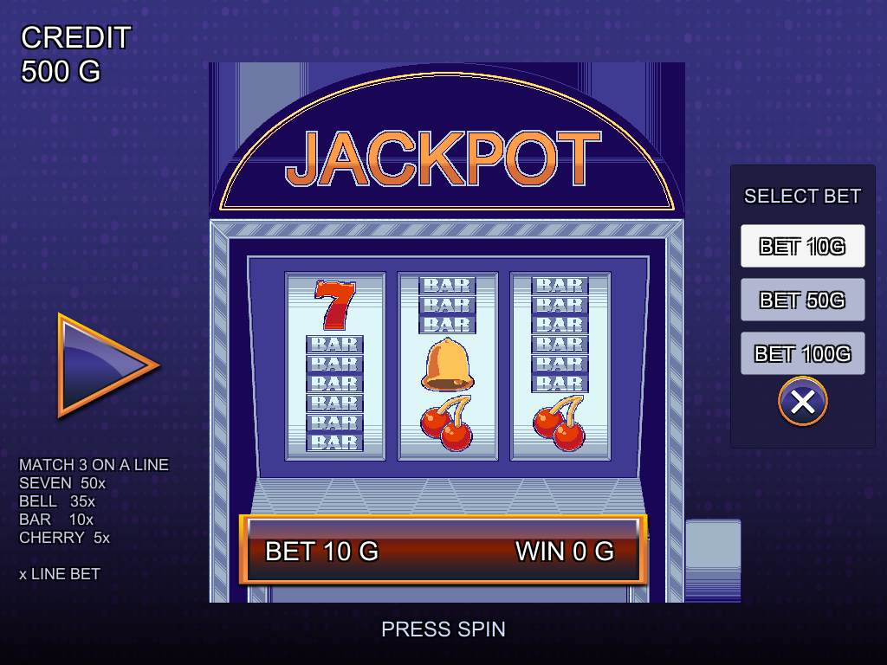
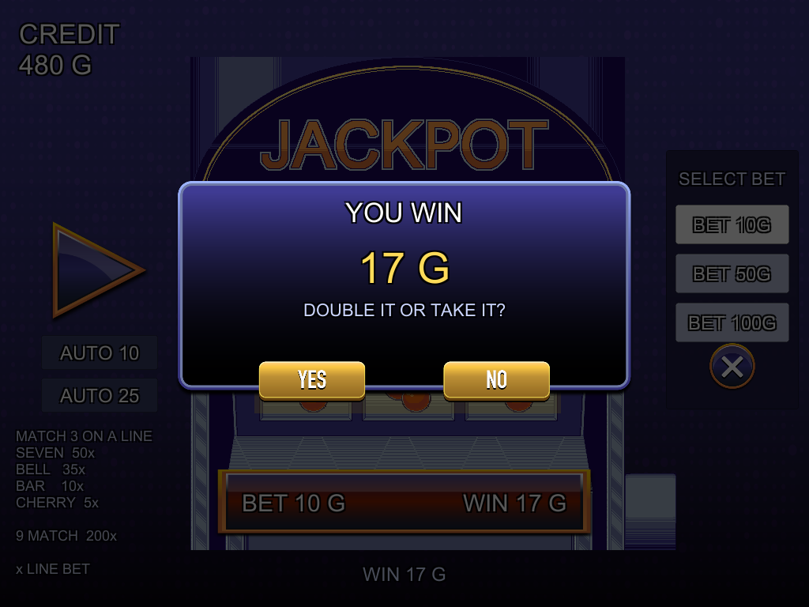
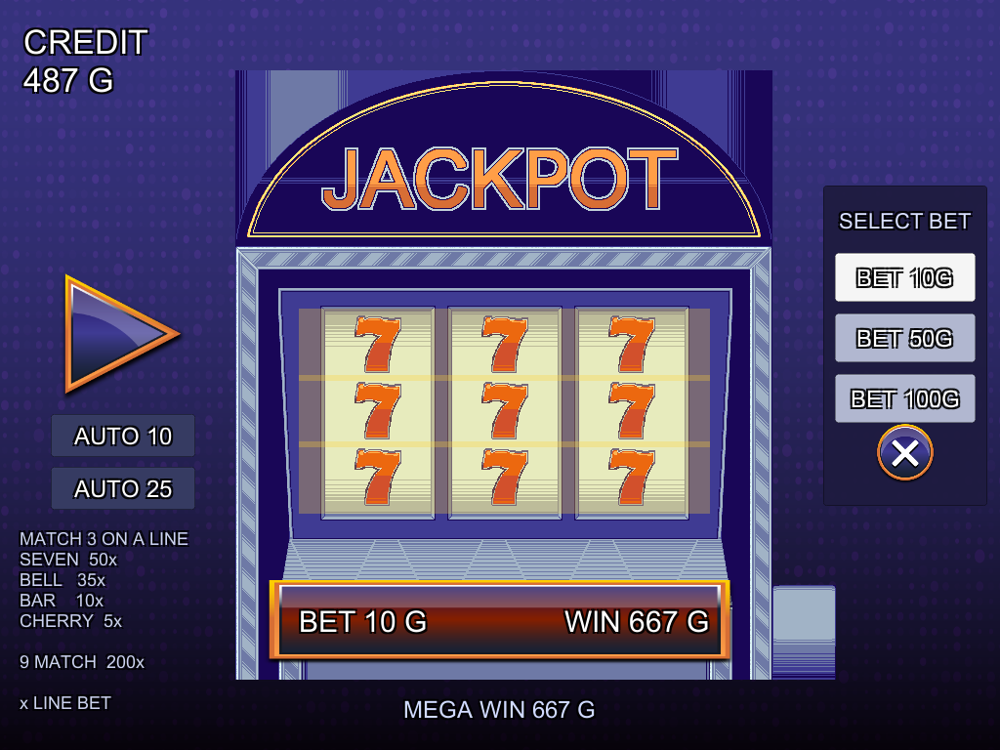

# Slot Machine — Unity Assignment

A three-reel, three-row slot machine built in Unity 2022.3 LTS from the supplied art pack.
Spin the reels, match three symbols on a payline, and decide whether to keep the win or
gamble it for double.

### ▶ [Play in the browser](https://anniket074.github.io/unity-slot-game/)

No install, no clone — the link opens the WebGL build directly.



| Spinning | Winning payline | Gamble offer | Mega win |
|---|---|---|---|
|  |  |  |  |

---

## Game overview

- **3 reels × 3 rows**, three paylines (top, middle, bottom).
- A **payline pays when all three reels show the same symbol** on that row.
- **All nine cells matching** pays the mega prize — the cabinet does say JACKPOT.
- Three bet levels (**10 / 50 / 100**), a starting balance of **500**, and a paytable shown
  in-game on the left of the cabinet.
- Winning lines are highlighted with a pulsing glow; a moment later the win popup offers
  **double-or-nothing** via the YES / NO buttons.
- The reference animation supplied with the art (`Design/reference-animation.gif`) was used
  as the layout brief: cabinet centre-screen, bet selector on the right, credits top-left.

### Paytable

Payouts are a multiple of the **line bet** (total bet ÷ 3 lines):

| Symbol | Match 3 on a line | Odds per cell | Odds on one line |
|---|---|---|---|
| 7      | 50×               | 10 %          | 0.1 %  |
| Bell   | 35×               | 20 %          | 0.8 %  |
| BAR    | 10×               | 30 %          | 2.7 %  |
| Cherry | 5×                | 40 %          | 6.4 %  |

| Special | Pays | Odds |
|---|---|---|
| All 9 cells the same | **200× line bet** (replaces the line wins) | 1 in ~3,450 |

**Measured return to player: 94.27 %** over 500,000 simulated spins — see
[`Docs/rtp-report.txt`](Docs/rtp-report.txt). The simulation runs the same `SpinRules` code
that pays the player, so the published number cannot drift from the game.

The numbers are data, not code: change the weights or multipliers on the `SymbolDefinition`
assets and both the game and the simulation use them immediately.

---

## Running the game

### WebGL (recommended)

**Play it here: <https://anniket074.github.io/unity-slot-game/>**

That URL is published by `.github/workflows/deploy-pages.yml`, which deploys the committed
`Build/WebGL` folder to GitHub Pages on every push that touches it.

To run the build locally instead, the folder has to be served over HTTP — browsers refuse
to load WebGL builds from `file://`:

```bash
cd Build/WebGL
python -m http.server 8080
# then open http://localhost:8080
```

Any static server works (`npx serve`, `dotnet serve`, IIS, …). It also hosts directly on
itch.io.

Click once inside the game window before using the keyboard — browsers give the canvas
keyboard focus only after a click (the mouse works immediately).

### Windows

Run `Build/Windows/SlotMachine.exe` (built locally, not committed — see *Building*).

### Controls

| Action | Input |
|---|---|
| Spin | Click the large triangle button, or press **Space** |
| Autoplay | **AUTO 10** / **AUTO 25** on the left; press again to stop |
| Change bet | The three **BET** buttons on the right |
| Take a win | **NO** on the popup |
| Gamble a win | **YES** on the popup (50/50, up to 3 times) |
| Quit | The round **X** button |

---

## Bonus features

**Gamble (double-or-nothing).** After any win the machine offers to gamble it: a 50/50 roll
doubles the pending win or forfeits it, up to **3 times** per win. It uses the `popup.png`
panel and the `Yes_No_Btn.png` state strips from the art pack. The gamble is deliberately
even-money — no house edge on the gamble itself — so it changes volatility, not expected
return.

**Mega win.** A full-board match pays 200× the line bet and replaces the three line wins
rather than stacking on them, which keeps the RTP predictable. It is rarer than the
25,000-spin session a reviewer will ever play (~1 in 3,450), so it also carries its own
title in the win popup.

**Anticipation.** When the first two reels already match on a symbol worth 10× or more, the
last reel is given a longer, lazier deceleration instead of stopping on the same beat. The
outcome is decided before the reels move, so this is pure presentation — it never changes
what pays, it just gives the near-miss a beat of suspense. Low symbols (cherries) stay quiet
so the tease stays meaningful.

**Autoplay.** AUTO 10 / AUTO 25 runs that many spins back to back. Small wins are collected
silently so the machine keeps rolling; it stops early and hands you the popup if a win
reaches 10× the bet, and stops on its own when the balance can no longer cover the bet.
Pressing the button again (or Space) stops it immediately.

---

## Thought process / approach

**1. Outcome first, animation second.**
The most common way to get a slot wrong is to randomise the symbol at the moment a reel
stops. That makes the result impossible to audit and lets the visual result drift from the
paid result. Here `SpinOutcomeGenerator` builds the entire 3×3 grid *before any reel moves*;
each `Reel` is then handed the three symbols it must land on and scrolls a strip of random
filler down to them. `SpinRules` scores the exact array the player sees. There is no code
path where a reel can invent a symbol.

**2. One definition of the payout rules.**
`SpinRules.Evaluate` is the only place a spin is priced. The machine calls it to pay the
player; the RTP simulator calls it to produce the number in this README. That is why the
documented RTP can be trusted — and why adding the mega prize could not silently unbalance
the game.

**3. Separate rules from presentation.**
`SlotMachine` owns the wallet, the bet, the outcome and the payout, and exposes C# events
(`SpinStarted`, `SpinResolved`, `GambleResolved`, `AutoPlayChanged`, …). `SlotMachineView`
subscribes and does nothing but update texts, buttons, highlights and the popup. Replacing
the entire UI would not touch a single rule.

**4. RNG behind an interface.**
Every random decision goes through `IRandomSource`. Production uses `SystemRandomSource`;
the simulator injects a seeded one, which makes the game reproducible and the distribution
checkable. Symbol frequency is a weighted pick (`WeightedPicker`), so the RTP is a
consequence of data rather than hard-coded odds.

**5. Make the reels feel physical.**
`SpinCurve` is a constant-speed cruise followed by a cubic ease-out tail, joined so that
both position *and* velocity are continuous — that is what stops deceleration from
"kicking" as the reel lands. The anticipation pass simply uses a different tail; the reels
stop in a staggered cascade (0.16 s apart) with a small overshoot-and-settle.

**6. Build the scene from code.**
The scene, prefabs, ScriptableObjects and the win-pulse animation are generated by
`ProjectBuilder` (`Slot Game → 1. Build Project`). The layout is then reviewable in source
control, reproducible, and impossible to break by a stray drag in the editor.

**7. Keep the art honest.**
Pixel art uses Point filtering and no compression; the four-frame button strips and the
Yes/No sheet are sliced into named sprites on import by `ArtImportPostprocessor`. A small
`SpriteStateButton` swaps those frames for normal / hover / pressed / disabled instead of
using Unity's colour tinting, so the buttons keep the hand-drawn look.

---

## Project structure

```
Assets/
  Art/
    Symbols/      four symbol sprites (96×96 pixel art)
    Machine/      cabinet art + message strip
    Buttons/      four-frame button strips, Yes/No sheet
  UI/             background gradient, popup panel
  Scripts/
    Core/         IRandomSource, SystemRandomSource, WeightedPicker, SpinCurve
    Data/         SymbolDefinition, GameConfig (ScriptableObjects)
    Machine/      SlotMachine, Reel, SpinOutcomeGenerator, PaylineEvaluator, SpinRules
    Economy/      Wallet
    UI/           SlotMachineView, SpriteStateButton, QuitButton
    Diagnostics/  SmokeTestRunner, CaptureRunner, RtpSimulator
  Editor/         ProjectBuilder (scene generator), ArtImportPostprocessor, BuildScript
  Prefabs/        SymbolTile
  Animations/     WinPulse clip + controller
  Settings/       GameConfig + four SymbolDefinition assets
  Scenes/         Main
Build/WebGL/      shippable WebGL build
Design/           the reference animation from the art pack
Docs/             RTP report and a saved smoke-test run
Screenshots/      images used above
```

---

## Building

Open `Assets/Scenes/Main.unity` in Unity **2022.3.62f3**, then:

- `Slot Game → 1. Build Project` — regenerates ScriptableObjects, prefab, animation and scene.
- `Slot Game → 2. Build Windows Player` — output in `Build/Windows`.
- `Slot Game → 3. Build WebGL` — output in `Build/WebGL`.

All three also run from the command line, which is how this project was built:

```bash
Unity.exe -batchmode -quit -projectPath . \
  -executeMethod SlotGame.EditorTools.ProjectBuilder.BuildAll -logFile Logs/build.log

Unity.exe -batchmode -projectPath . \
  -executeMethod SlotGame.EditorTools.BuildScript.BuildWebGL -logFile Logs/webgl.log
```

---

## Verification

The build ships with three command-line self-checks (see `Assets/Scripts/Diagnostics`):

```bash
# 30 scripted spins + 3 autoplay spins: asserts every debit matches the bet,
# then confirms autoplay returns the machine to idle
SlotMachine.exe -autotest Docs/autotest-sample.txt

# 500,000 spins through the real payout rules -> RTP, hit rate, mega frequency
SlotMachine.exe -rtp 500000 Docs/rtp-report.txt

# scripted screenshots (idle, spin, win line, gamble popup, mega win)
SlotMachine.exe -capture Screenshots/capture
```

Both the saved report and the RTP simulation are committed, so the claims in this README
can be re-run rather than taken on trust.

---

## What I would do next

- Replace the three independent per-cell rolls with a **weighted strip** per reel so symbol
  frequency, near-misses and RTP can be tuned as a single table.
- Add **free spins** and a scatter symbol — the supplied art has no scatter, so this would
  need one new sprite.
- Move the paytable into an on-screen panel with symbol icons rather than text.
- Add EditMode tests around `PaylineEvaluator` and `SpinRules` so the rules are covered
  without needing to run the player.
