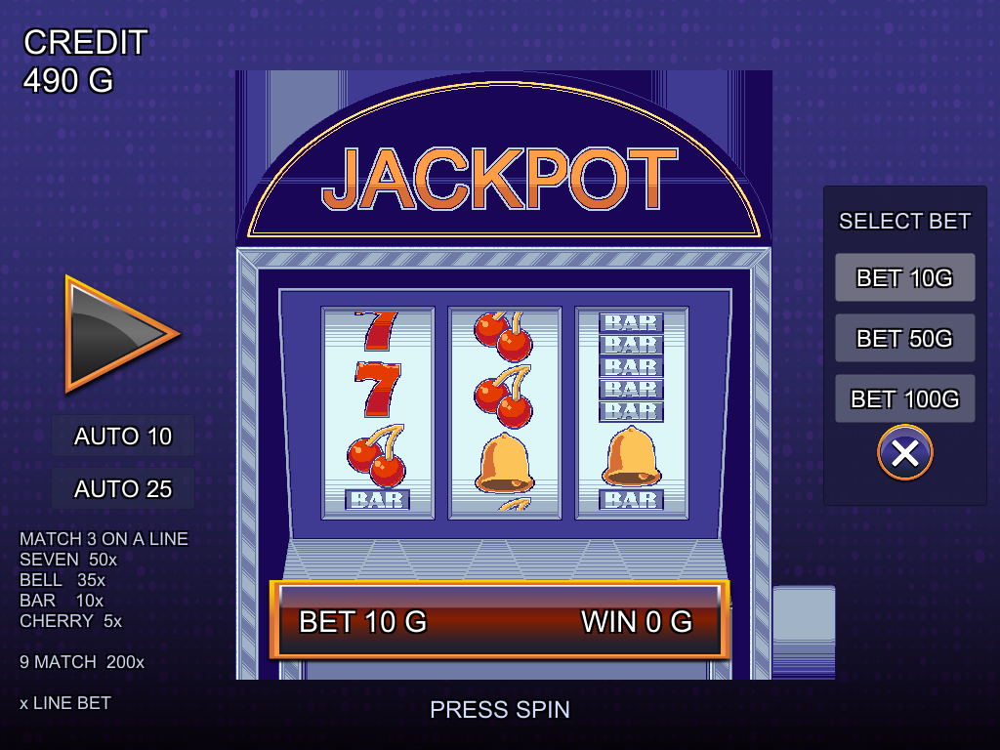
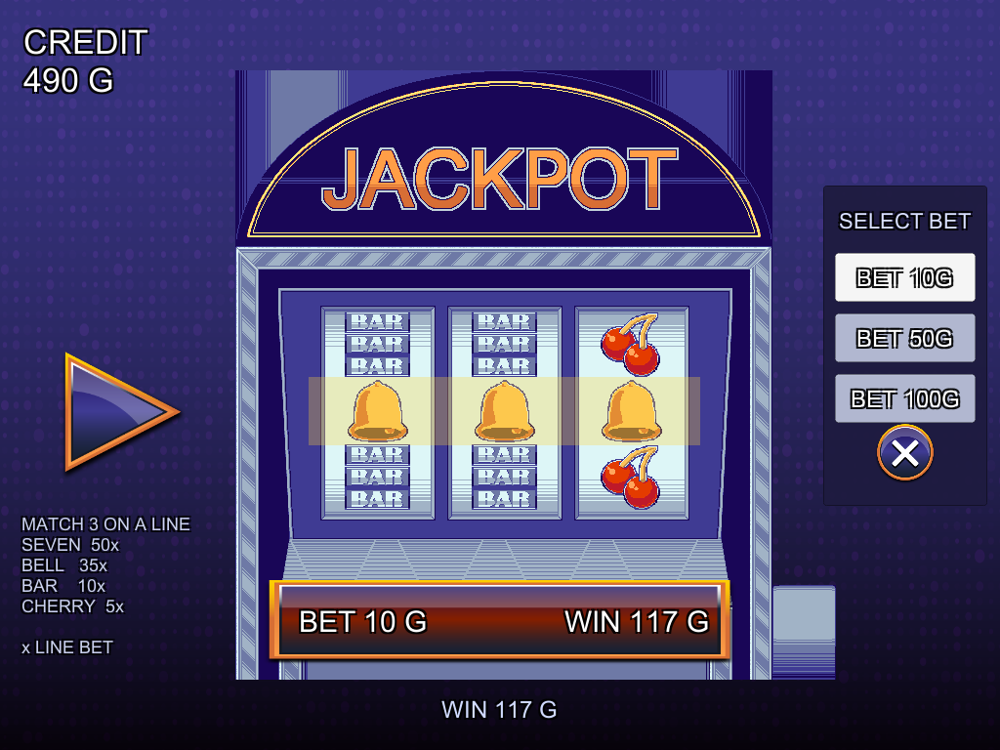

# Slot Machine — Unity Assignment

A three-reel, three-row slot machine built in Unity 2022.3 LTS from the supplied art pack.
Spin the reels, match three symbols on a payline, and decide whether to keep the win or
gamble it for double.


| Spinning | Winning payline | Gamble offer |
|---|---|---|
|  |  |  |

---

## Game overview

- **3 reels × 3 rows**, three paylines (top, middle, bottom).
- A **payline pays when all three reels show the same symbol** on that row.
- Three bet levels (**10 / 50 / 100**), a starting balance of **500**, and a paytable shown
  in-game on the left of the cabinet.
- Winning lines are highlighted with a pulsing glow; a moment later the win popup offers
  **double-or-nothing** via the YES / NO buttons.
- The reference animation supplied with the art (`Design/reference-animation.gif`) was used
  as the layout brief: cabinet centre-screen, bet selector on the right, credits top-left.

### Paytable

Payouts are a multiple of the **line bet** (total bet ÷ 3 lines):

| Symbol | Payout (× line bet) | Odds per cell | Odds on one line |
|---|---|---|---|
| 7      | 50×                 | 10 %          | 0.1 %  |
| Bell   | 35×                 | 20 %          | 0.8 %  |
| BAR    | 10×                 | 30 %          | 2.7 %  |
| Cherry | 5×                  | 40 %          | 6.4 %  |

Combined **return to player ≈ 92 %** (Σ odds × payout), which is a realistic
slot-machine figure rather than a guaranteed-win one. The numbers are data, not code:
change the weights or multipliers on the `SymbolDefinition` assets and the game uses them
immediately.

---

## Running the game

### WebGL (recommended)

The build is in **`Build/WebGL`**. Browsers refuse to load WebGL builds from `file://`,
so serve the folder over HTTP:

```bash
cd Build/WebGL
python -m http.server 8080
# then open http://localhost:8080
```

Any static server works (`npx serve`, `dotnet serve`, IIS, …). It also hosts directly on
GitHub Pages or itch.io.

Click once inside the game window before using the keyboard — browsers give the canvas
keyboard focus only after a click (the mouse works immediately).

### Windows

Run `Build/Windows/SlotMachine.exe` (built locally, not committed — see *Building*).

### Controls

| Action | Input |
|---|---|
| Spin | Click the large triangle button, or press **Space** |
| Change bet | The three **BET** buttons on the right |
| Take a win | **NO** on the popup |
| Gamble a win | **YES** on the popup (50/50, up to 3 times) |
| Quit | The round **X** button |

---

## Bonus feature: gamble (double-or-nothing)

After any win the machine offers to gamble it: a 50/50 roll doubles the pending win or
forfeits it, up to **3 times** per win. It uses the `popup.png` panel and the `Yes_No_Btn.png`
state strips from the art pack, which is why it was chosen over a free-spins feature that
the art does not support (there is no scatter symbol in the supplied set).

The gamble is deliberately even-money — no house edge on the gamble itself — so it changes
volatility, not expected return.

---

## Thought process / approach

**1. Outcome first, animation second.**
The most common way to get a slot wrong is to randomise the symbol at the moment a reel
stops. That makes the result impossible to audit and lets the visual result drift from the
paid result. Here `SpinOutcomeGenerator` builds the entire 3×3 grid *before any reel moves*;
each `Reel` is then handed the three symbols it must land on and scrolls a strip of random
filler down to them. `PaylineEvaluator` scores the exact array the player sees. There is no
code path where a reel can invent a symbol.

**2. Separate rules from presentation.**
`SlotMachine` owns the wallet, the bet, the outcome and the payout, and exposes C# events
(`SpinStarted`, `SpinResolved`, `GambleResolved`, …). `SlotMachineView` subscribes and does
nothing but update texts, buttons, highlights and the popup. Replacing the entire UI would
not touch a single rule.

**3. RNG behind an interface.**
Every random decision goes through `IRandomSource`. Production uses `SystemRandomSource`;
tests can inject a seeded source, which makes the machine reproducible and the distribution
checkable. Symbol frequency is a weighted pick (`WeightedPicker`), so the RTP is a
consequence of data rather than hard-coded odds.

**4. Make the reels feel physical.**
`SpinCurve` is a constant-speed cruise followed by a cubic ease-out tail, joined so that
both position *and* velocity are continuous — that is what stops deceleration from
"kicking" as the reel lands. Reels stop in a staggered cascade (0.16 s apart) with a small
overshoot-and-settle on landing, which is the detail that makes a slot read as mechanical
rather than as UI sliding.

**5. Build the scene from code.**
The scene, prefabs, ScriptableObjects and the win-pulse animation are generated by
`ProjectBuilder` (`Slot Game → 1. Build Project`). The layout is then reviewable in source
control, reproducible, and impossible to break by a stray drag in the editor.

**6. Keep the art honest.**
Pixel art uses Point filtering and no compression; the four-frame button strips and the
Yes/No sheet are sliced into named sprites on import by `ArtImportPostprocessor`. A small
`SpriteStateButton` swaps those frames for normal / hover / pressed / disabled instead of
using Unity's colour tinting, so the buttons keep the hand-drawn look.

---

## Project structure

```
Assets/
  Art/
    Symbols/      four symbol sprites (96×96 pixel art)
    Machine/      cabinet art + message strip
    Buttons/      four-frame button strips, Yes/No sheet
  UI/             background gradient, popup panel
  Scripts/
    Core/         IRandomSource, SystemRandomSource, WeightedPicker, SpinCurve
    Data/         SymbolDefinition, GameConfig (ScriptableObjects)
    Machine/      SlotMachine, Reel, SpinOutcomeGenerator, PaylineEvaluator, tile view
    Economy/      Wallet
    UI/           SlotMachineView, SpriteStateButton, QuitButton
    Diagnostics/  SmokeTestRunner, CaptureRunner
  Editor/         ProjectBuilder (scene generator), ArtImportPostprocessor, BuildScript
  Prefabs/        SymbolTile
  Animations/     WinPulse clip + controller
  Settings/       GameConfig + four SymbolDefinition assets
  Scenes/         Main
Build/WebGL/      shippable WebGL build
Design/           the reference animation from the art pack
Screenshots/      images used above
```

---

## Building

Open `Assets/Scenes/Main.unity` in Unity **2022.3.62f3**, then:

- `Slot Game → 1. Build Project` — regenerates ScriptableObjects, prefab, animation and scene.
- `Slot Game → 2. Build Windows Player` — output in `Build/Windows`.
- `Slot Game → 3. Build WebGL` — output in `Build/WebGL`.

All three also run from the command line, which is how this project was built:

```bash
Unity.exe -batchmode -quit -projectPath . \
  -executeMethod SlotGame.EditorTools.ProjectBuilder.BuildAll -logFile Logs/build.log

Unity.exe -batchmode -projectPath . \
  -executeMethod SlotGame.EditorTools.BuildScript.BuildWebGL -logFile Logs/webgl.log
```

---

## Verification

The build ships with two command-line self-checks (see `Assets/Scripts/Diagnostics`):

```bash
# 30 scripted spins: asserts every spin debits exactly the bet and resolves a payout
SlotMachine.exe -autotest Logs/autotest.txt

# scripted screenshots (idle, spin, win line, gamble popup) for the README
SlotMachine.exe -capture Screenshots/capture
```

A sample `-autotest` report is committed as `Docs/autotest-sample.txt`. It runs 30 spins
through the real scene and asserts that each one debits exactly the bet, then records the
win and the resulting balance (payouts follow the paytable: 17 for a cherry line, 33 for a
BAR line at a 10 bet, and so on).

---

## What I would do next

- Replace the three independent per-cell rolls with a **weighted strip** per reel so symbol
  frequency, near-misses and RTP can be tuned as a single table.
- Add **free spins** and a scatter symbol — the supplied art has no scatter, so this would
  need one new sprite.
- Move the paytable into a proper on-screen panel with the symbol icons rather than text.
- Add EditMode tests around `PaylineEvaluator` and a Monte Carlo run over 10⁶ spins to
  confirm the 92 % RTP empirically (the generator is already seedable for exactly this).
